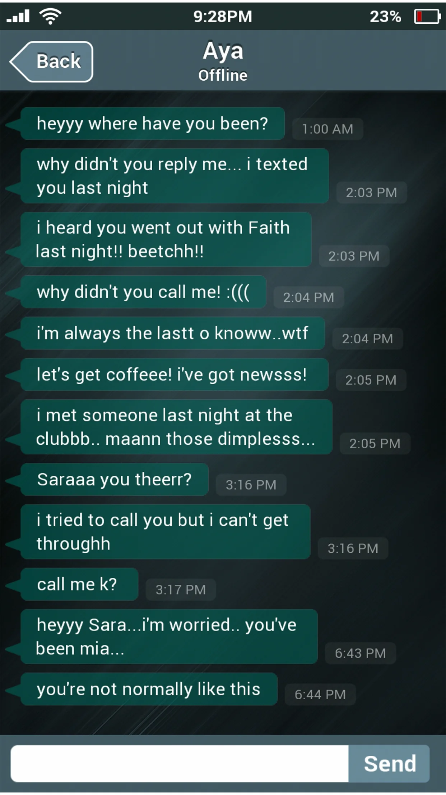
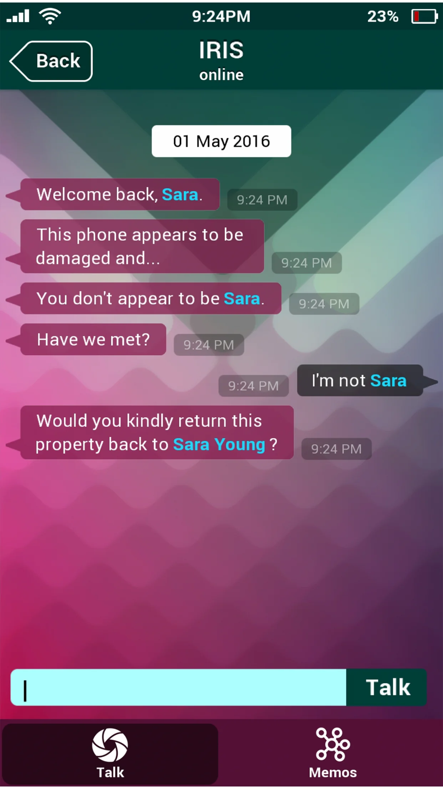

You found a phone belonging to a missing person. What would you do?
Sara has disappeared under mysterious circumstances, and your only lead is her mobile phone. 

Search for clues by investigating Sara's personal messages, notes, emails, pictures and videos while trying to piece together her final days. Unlock password protected files, uncover hidden messages and decrypt lost data and figure out where she went, what she did, and how someone can disappear without a trace so suddenly.

Features:
- Multiple choices will lead to multiple outcomes and endings.
- Chat with different people at the same time.
- Receive phone calls from NPCs and other mysterious callers.
- Hidden sub plots and extra information to unlock.
- Receive videos and photos from other NPCs.
- Simulated mobile phone helper, providing hints.
- Utilizing a similar typing mechanic as popular messaging apps.

More info at:
www.saraismissing.com

| | |
|---|---|
|  |  |
|  |  |
|  | |
